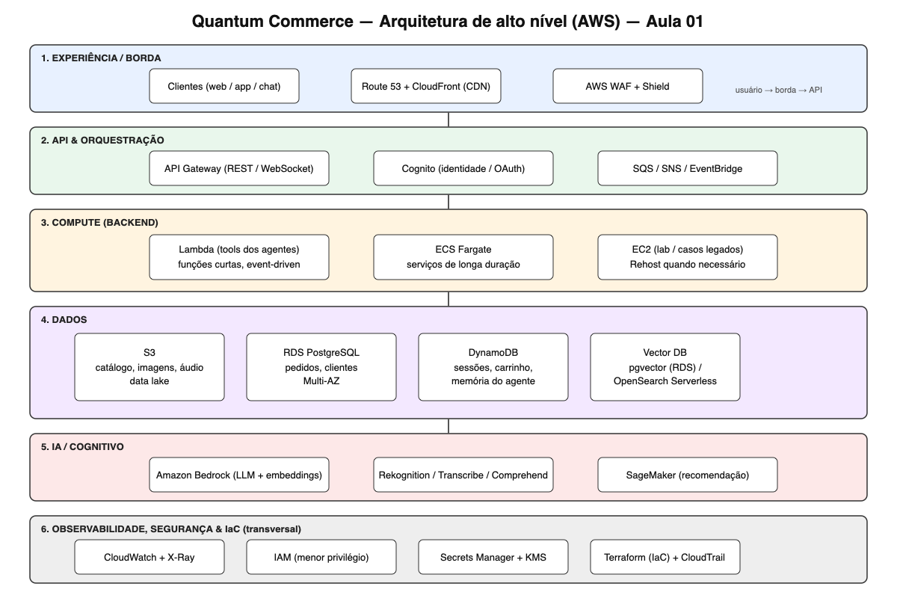

# Entrega 01 — Aula 1 (Fundamentos & IaC) — Grupo 01

**Disciplina:** Cloud & Cognitive Environments
**Professor:** Isaías Silva de Britto
**Turma:** 6AIER
**Data de entrega:** 22/11/2026

## Grupo

| # | Nome completo | GitHub | E-mail FIAP |
|---|---------------|--------|-------------|
| 1 | Cinara Nubia Silva (RM 379045) | — | rm379045@fiap.com.br |
| 2 | Guilherme Augusto Veiga Pires (RM 379110) | gguilhermepires | rm379110@fiap.com.br |
| 3 | Somario Canuto da Silva (RM 379214) | — | rm379214@fiap.com.br |

## Distribuição do trabalho

| Membro | Nível assumido | Item específico |
|--------|----------------|-----------------|
| Cinara Nubia Silva | 🟢 N1 | Exercícios 1.1–1.4 (modelos de serviço, 6 Rs, SLA, IAM) |
| Somario Canuto da Silva | 🟡 N2 | Exercícios 2.1–2.3 (arquitetura e diagrama, comparativo de custos, migração) |
| Guilherme Augusto Veiga Pires | 🔴 N3 (bônus) + reflexão | Exercícios 3.1–3.3 (Terraform, CloudFormation, multi-cloud) e reflexão coletiva; revisão final do documento |

---

## 🟢 Nível 1 — Respostas

### Exercício 1.1 — Mapeamento de modelos de serviço

| Serviço | Modelo | Justificativa |
|---------|--------|---------------|
| Gmail | SaaS | Aplicação completa entregue ao usuário final; não há infraestrutura para gerenciar. |
| Amazon EC2 | IaaS | A AWS entrega a máquina virtual; SO, patches e aplicações ficam por nossa conta. |
| AWS Elastic Beanstalk (API) | PaaS | A AWS cuida de SO, runtime e escalonamento; só publicamos o código. |
| AWS Lambda | FaaS | Só escrevemos a função; não há servidor fixo e a cobrança é por execução. |
| Amazon RDS for PostgreSQL | PaaS | A AWS gerencia motor, backup e patches; nós gerenciamos esquema e dados. |
| Salesforce CRM | SaaS | Aplicação de negócio completa consumida como serviço. |
| Google Kubernetes Engine (GKE) | PaaS / IaaS (híbrido) | O Google gerencia o plano de controle do K8s; nós cuidamos de pods, workloads e (no modo Standard) dos nós. |
| Amazon S3 | PaaS | Armazenamento gerenciado; só controlamos dados e políticas de acesso. |
| Amazon Bedrock | SaaS / API-as-a-Service | Modelos prontos consumidos via API, sem gerenciar infraestrutura nem o modelo. |

### Exercício 1.2 — Os 6 Rs na prática

| Cenário | R escolhido | Justificativa |
|---------|-------------|---------------|
| A — Rastreamento de frotas (2008, sem documentação, um único mantenedor) | **Rehost** | O objetivo é migrar rápido para ganhar elasticidade. Sem documentação e com um só mantenedor, mexer no código seria arriscado; lift & shift evita isso. |
| B — ERP de RH com menos de 5 usuários/mês | **Retire** | O custo de migrar supera o valor gerado. Arquiva-se o dado em storage frio e desliga-se o sistema. |
| C — API de pagamentos monolítica → microserviços com K8s e event-driven | **Refactor** | A decisão de redesenhar a arquitetura já foi tomada. É o maior esforço, mas entrega o maior ganho de escala e agilidade. |
| D — CRM interno de 15 anos; SaaS cobre 90% das necessidades | **Repurchase** | Um produto de mercado atende quase tudo por menor custo e elimina a manutenção de software próprio. |
| E — Mainframe com dados de clientes que devem ficar on-premise (Banco Central) | **Retain** | A exigência regulatória define a localização. Manter não é falha de estratégia; o conformidade vem primeiro. |

### Exercício 1.3 — Impacto do SLA (99,9%)

- **a) Downtime anual:** 8.760 × (1 − 0,999) = **8,76 horas/ano** (≈ 525 min).
- **b) Impacto financeiro máximo:** 8,76 h × R$ 50.000/h = **R$ 438.000/ano**.
- **c) SLA mínimo para ficar abaixo de R$ 50.000/ano:** o downtime máximo é 50.000 ÷ 50.000 = 1 h/ano. Então 1 ÷ 8.760 ≈ 0,0114%, o que exige SLA ≥ **99,9886%**. Na prática, **SLA de 99,99%** (≈ 52 min/ano, ≈ R$ 43.800/ano).

### Exercício 1.4 — IAM na prática

| Perfil | Política IAM mais adequada | Justificativa |
|--------|---------------------------|---------------|
| Agente de IA que **lê** produtos do S3 | Política customizada: `s3:GetObject` + `s3:ListBucket` restritos ao ARN do bucket/prefixo do catálogo, anexada a uma role do agente | Menor privilégio. `AmazonS3ReadOnlyAccess` leria todos os buckets da conta, o que é excessivo. |
| Engenheiro de dados que **carrega** catálogos no S3 | Política customizada com `s3:PutObject` restrito ao prefixo `catalogo/` (e `s3:ListBucket` no bucket) | Só escreve onde precisa; não pode apagar nem ler dados de outras áreas. |
| Time de FinOps que **vê** custos sem alterar recursos | `AWSBillingReadOnlyAccess` (ou leitura do Cost Explorer) | Visibilidade total de custos sem nenhuma permissão de escrita sobre recursos. |
| Auditor externo que **lê** configurações da conta | `SecurityAudit` (ou `ViewOnlyAccess`), via **role assumida** com prazo | Leitura de configurações sem usuário IAM permanente, o que reduz risco de credencial esquecida. |
| CI/CD que provisiona infra via Terraform | **Role dedicada via OIDC** (GitHub Actions) com permissões só dos serviços do projeto | Sem chaves de acesso de longa duração. Nunca `AdministratorAccess`. |

**Princípio aplicado:** menor privilégio possível para a tarefa, usando roles temporárias em vez de usuários e chaves permanentes.

---

## 🟡 Nível 2 — Respostas + Implementação

### Exercício 2.1 — Arquitetura de alto nível da Quantum Commerce

**Contexto:** 12 países, 5 milhões de SKUs e IA conversacional como diferencial. A arquitetura precisa servir **agentes** que consultam catálogo (busca semântica), executam ações (tools via API) e mantêm memória de conversa.



#### 1. Camadas

| # | Camada | Função |
|---|--------|--------|
| 1 | Experiência / Borda | Entrada dos clientes (web, app, chat), DNS, CDN e proteção contra ataques (WAF). Baixa latência nos 12 países. |
| 2 | API & Orquestração | API Gateway como ponto único de entrada, identidade (Cognito) e mensageria (SQS/SNS/EventBridge) para desacoplar fluxos assíncronos. |
| 3 | Compute (backend) | Lambda para as *tools* dos agentes (curtas, sob demanda) e ECS Fargate para serviços de longa duração. EC2 só para casos legados (Rehost). |
| 4 | Dados | S3 (catálogo, imagens, áudio), RDS PostgreSQL (pedidos/clientes), DynamoDB (sessão, carrinho, memória do agente) e banco vetorial (busca semântica). |
| 5 | IA / Cognitivo | Bedrock (LLM e embeddings), Rekognition/Transcribe/Comprehend (imagem, voz, sentimento) e SageMaker (recomendação). |
| 6 | Transversal | Observabilidade (CloudWatch/X-Ray), segurança (IAM, KMS, Secrets Manager, CloudTrail) e IaC (Terraform). |

#### 2. Provedor principal: **AWS**

- Catálogo mais completo para o que o case exige: Bedrock, banco vetorial gerenciado, Lambda/Fargate e serviços cognitivos prontos.
- Presença global (regiões na América do Sul e Europa) e CDN madura para atender 12 países.
- Maior base de documentação e labs da disciplina, o que reduz risco de execução do grupo.
- Os demais provedores seguem como alternativa (ver tabela) e como candidatos a uma estratégia multi-cloud futura, se o lock-in virar preocupação.

#### 3. Serviços por categoria

| Categoria | Serviço AWS | Alternativa Azure | Alternativa GCP |
|-----------|-------------|-------------------|-----------------|
| Compute (backend) | Lambda + ECS Fargate | Azure Functions + Container Apps | Cloud Functions + Cloud Run |
| Storage (catálogo, imagens) | S3 | Blob Storage | Cloud Storage |
| Banco relacional | RDS for PostgreSQL | Azure Database for PostgreSQL | Cloud SQL for PostgreSQL |
| Banco NoSQL | DynamoDB | Cosmos DB | Firestore / Bigtable |
| Vector Database | pgvector no RDS (início) ou OpenSearch Serverless | Azure AI Search | Vertex AI Vector Search |
| Serviços de IA cognitivos | Bedrock, Rekognition, Transcribe, Comprehend | Azure OpenAI, AI Vision, AI Speech, AI Language | Vertex AI, Vision AI, Speech-to-Text, Natural Language |
| CDN | CloudFront | Azure Front Door / CDN | Cloud CDN |
| Mensageria / Filas | SQS + SNS + EventBridge | Service Bus + Event Grid | Pub/Sub |
| Observabilidade | CloudWatch + X-Ray | Azure Monitor + App Insights | Cloud Monitoring + Cloud Trace |

#### 4. Comunicação entre camadas (fluxo de uma pergunta ao agente)

1. O cliente chega pela borda (CloudFront + WAF) e autentica no Cognito.
2. O API Gateway encaminha para a Lambda que hospeda o agente/tool.
3. A tool gera o embedding da pergunta (Bedrock), busca produtos similares no banco vetorial e enriquece com dados do RDS.
4. O estado da conversa fica no DynamoDB; imagens, áudio e catálogo ficam no S3.
5. Ações assíncronas (pedido, notificação) saem por SQS/EventBridge.
6. Tudo é rastreado em CloudWatch/X-Ray e provisionado por Terraform.

---

### Exercício 2.2 — Comparativo de custos: 3 provedores

> ✅ **Valores conferidos nas calculadoras oficiais** (calculator.aws, azure.microsoft.com/pricing/calculator, cloud.google.com/products/calculator) em 17/11/2026, preço on-demand, Linux, região EUA (AWS us-east-2 Ohio, Azure East US, GCP us-central1 Iowa), USD/mês, 730 h/mês, sem créditos nem free tier de conta nova. Os prints estão em `evidencias/2.2-*.jpg`. Preços mudam e variam por região.

**Premissas:** VM 2 vCPU/8 GB (24/7); 500 GB de object storage (camada padrão); banco PostgreSQL gerenciado 2 vCPU/8 GB/100 GB SSD, instância única (sem alta disponibilidade); 10 M req/mês em função serverless com 512 MB e ~200 ms por execução.

| Item | AWS | Azure | GCP | Notas |
|------|-----|-------|-----|-------|
| 2 × VM (2 vCPU/8 GB) | US$ 140,16 | US$ 140,16 | US$ 99,84 | Tipo: AWS `m5.large` (On-Demand, não Savings Plan); Azure `D2s v5`; GCP `e2-standard-2` |
| 500 GB storage | US$ 11,50 | US$ 11,44 | US$ 9,90 | Tipo: S3 Standard; Blob Hot (LRS), já com operações padrão da calculadora; Cloud Storage Standard |
| Banco gerenciado | US$ 141,44 | US$ 141,44 | US$ 118,18 | Tipo: RDS PostgreSQL `db.m5.large` Single-AZ + 100 GB gp2 (sem RDS Proxy nem Database Insights); Azure Flexible Server `D2ds v5` + 100 GiB Premium SSD; Cloud SQL 2 vCPU/8 GiB + 100 GiB SSD |
| 10 M req serverless | US$ 11,80 | US$ 11,40 | US$ 53,70 | Tipo: Lambda 512 MB/200 ms; Functions Consumption 512 MB/200 ms; Cloud Run (concorrência 20, tráfego estável, sem instância mínima), a entrada "funções" da calculadora do GCP |
| **Total mensal** | **US$ 304,90** | **US$ 304,44** | **US$ 281,61** | |
| **Total anual** | **≈ US$ 3.659** | **≈ US$ 3.653** | **≈ US$ 3.379** | |

Prints: AWS `2.2-aws-01…05`, Azure `2.2-azure-01…03`, GCP `2.2-gcp-01…04` (a pasta `evidencias/`).

**Análise**

**a) Qual ficou mais barato? A diferença é significativa?**
O GCP ficou mais barato (US$ 281,61/mês), cerca de 7,6% abaixo da AWS e 7,5% abaixo do Azure. AWS e Azure ficaram praticamente empatados (diferença de 0,1%). São ~US$ 280/ano de diferença, o que não é decisivo sozinho para um projeto pequeno. A vantagem do GCP vem das VMs e do banco; já na linha serverless a calculadora do GCP deu US$ 53,70 contra ~US$ 12 de AWS e Azure, porque o Cloud Run cobra CPU e memória alocadas por instância. Sem essa linha, o GCP seria ~22% mais barato (US$ 227,92 contra US$ 293,10 da AWS), então o resultado depende do modelo serverless escolhido, não só do preço por hora.

**b) Reserved Instances de 1 ano no mais caro (AWS) mudam o resultado?**
Sim. Com RI de 1 ano (sem pagamento antecipado), VMs e RDS caem cerca de 35–40%: EC2 ≈ US$ 88 e RDS ≈ US$ 83 + US$ 11,50 de disco. O total AWS vai a ≈ **US$ 206/mês (≈ US$ 2.470/ano)**, abaixo do GCP on-demand (US$ 281,61). Esses valores de RI são estimativa a partir da tabela pública de preços (não foram simulados na calculadora). Para ser justo, o GCP com Committed Use Discount de 1 ano também baixaria (~25–30%), então o ranking depende de comparar compromisso com compromisso. A lição é que **o modelo de contratação pesa mais que o provedor**.

**c) Outros fatores além de preço para um projeto de IA**
- **Catálogo de IA:** modelos disponíveis (Bedrock, Azure OpenAI, Vertex AI), cotas e disponibilidade por região.
- **Latência e residência de dados** (LGPD/GDPR) nos 12 países.
- **Custo de saída de dados (egress)** e de GPU/inferência, que domina o custo em IA.
- **Maturidade de MLOps e vector DB gerenciado.**
- **Integração com o ecossistema atual da equipe**, suporte e conhecimento do time.
- **Segurança e governança de agentes** (IAM, auditoria, guardrails) e risco de lock-in.

---

### Exercício 2.3 — Estratégia de migração (contexto profissional)

> ℹ️ **Empresa fictícia:** a **LogiFrio Distribuidora** e os números de uso abaixo (usuários, tamanho do banco, picos) são hipóteses criadas para o exercício. Os valores em US$ vêm da calculadora oficial da AWS (calculator.aws, 17/11/2026), com prints em `evidencias/2.3-*.jpg`.

**a) Workload:** a LogiFrio é uma distribuidora regional de alimentos refrigerados (~400 funcionários, 6 centros de distribuição). O sistema escolhido é o **WMS** (gestão de pedidos e estoque), uma aplicação web monolítica em Java com banco PostgreSQL de ~300 GB, rodando em **2 servidores físicos** no datacenter da sede. Tem ~250 usuários internos e uma API usada pelos clientes para consultar pedidos. O pico é no fechamento do mês e na semana de Natal.

**b) R escolhido: Replatform.**
- **Custo:** elimina a renovação dos servidores e o suporte de hardware; passa a pagar por uso e a custo previsível (ver estimativa em c). A comparação com o custo atual on-premise deve ser feita pela LogiFrio.
- **Risco:** médio/baixo. O código muda pouco (conexão com o banco e armazenamento de arquivos) e as regras de negócio ficam como estão. Rehost manteria o mesmo trabalho de patch e backup em EC2, e Refactor (reescrever o monolito) é caro e arriscado para um sistema crítico.
- **Ganho:** banco gerenciado com backup, patches e failover automáticos (Multi-AZ); aplicação em contêineres que escala no pico; fim da dependência de hardware.
- **Prazo:** 10–12 semanas (empacotar em contêiner, montar a rede e o banco, testar e migrar os dados), contra 6+ meses de um Refactor.

**c) Serviços AWS e estimativa mensal** (calculadora AWS, região us-east-2, preço on-demand, sem free tier):

| Serviço | Configuração | US$/mês |
|---|---|---|
| RDS for PostgreSQL | `db.m5.large` (2 vCPU/8 GB), **Multi-AZ**, 300 GB gp2 (sem RDS Proxy nem Database Insights) | 328,88 |
| ECS Fargate | 2 tarefas de 1 vCPU/2 GB, 24×7 | 72,08 |
| Application Load Balancer | 1 ALB, ~0,1 GB/h processado | 17,01 |
| S3 Standard | 200 GB de documentos e anexos | 4,60 |
| **Total** | | **≈ US$ 422,57/mês (≈ US$ 5.071/ano)** |

- O banco é cerca de 78% do total. Em Single-AZ o RDS cairia para ≈ US$ 164 (instância US$ 129,94 + disco US$ 34,50), mas o WMS é crítico para a operação dos centros de distribuição, então mantemos Multi-AZ.
- **Fora da estimativa:** AWS DMS (só durante a migração), tráfego de saída de dados, CloudWatch, backups acima do espaço gratuito, WAF e VPN entre a sede/CDs e a AWS.

**d) Maior obstáculo e como endereçar:**
- **Técnico:** migrar ~300 GB de banco com pouca janela de indisponibilidade, já que os centros de distribuição operam quase 24 h. Usar AWS DMS com carga inicial e replicação contínua (CDC), ensaiar o *cutover* em ambiente de teste e executá-lo num fim de semana fora do fechamento do mês, mantendo o banco on-premise como fallback por alguns dias (plano de rollback).
- **Organizacional:** a equipe de infraestrutura tem pouca prática em cloud e teme perder o controle do ambiente. Endereçar com um piloto em ambiente de teste, treinamento curto e IaC (Terraform) para dar previsibilidade e revisão das mudanças.

---

## 🔴 Nível 3 — Bônus

> ✅ **Executado de verdade** em 12/11/2026 no AWS Learner Lab (região `us-east-1`), via AWS CloudShell. Cada passo tem uma captura de tela em `evidencias/`, citada abaixo como (E-NN). O `terraform destroy` e o `delete-stack` foram rodados ao final e não restou nenhuma instância.

### Exercício 3.1 — Terraform: endurecer a rede da VM (`terraform/`)

Partimos do `main.tf` do lab e fizemos quatro mudanças:

1. **SSH restrito ao IP do operador.** A regra de entrada da porta 22 deixou de usar `var.ssh_cidr` (default `0.0.0.0/0`) e passou a usar `"${var.meu_ip}/32"`. A variável `meu_ip` **não tem default**: sem informar o IP, o Terraform não aplica, então o SSH nunca fica aberto por esquecimento. Há também uma validação de formato.
2. **Novo `sg-app`** (`aws_security_group.app`) com uma regra `aws_vpc_security_group_ingress_rule` que aceita a porta 8080 **somente** com `referenced_security_group_id` apontando para o security group da VM. A regra referencia o grupo, não um CIDR, e continua valendo mesmo se o IP da VM mudar.
3. **Outputs:** `public_ip_address` (já existia) e o novo `app_security_group_id`.
4. **Plan:** a mudança do SSH é uma **atualização in-place** da regra de entrada do security group, e o `sg-app` é criado do zero. A instância EC2 **não é recriada**, porque o `aws_instance` só referencia o ID do security group, que não muda.

**Como foi executado** (E-08 a E-13):

1. Instalamos o Terraform 1.9.8 no `~/bin` do CloudShell e rodamos `terraform init` (E-08).
2. **Baseline:** aplicamos o `main.tf` **original do lab** (SSH aberto para `0.0.0.0/0`): `Apply complete! Resources: 4 added` (E-09).
3. Copiamos o estado para a pasta `terraform/` (versão endurecida) e rodamos `terraform plan -var "meu_ip=<IP do CloudShell>"`:

```text
# aws_security_group.web will be updated in-place
  ~ ingress = [
      - { cidr_blocks = ["0.0.0.0/0"],        description = "SSH",                         from_port = 22, to_port = 22, ... },
      + { cidr_blocks = ["18.234.25.103/32"], description = "SSH apenas do IP do operador", from_port = 22, to_port = 22, ... },
        # HTTP (80) e HTTPS (443) inalterados
    ]
# aws_security_group.app will be created
# aws_vpc_security_group_ingress_rule.app_da_vm will be created
# aws_vpc_security_group_egress_rule.app_saida will be created
Plan: 3 to add, 1 to change, 0 to destroy.
```

`aws_instance.vm` **não aparece** no plano (contagem de ocorrências: 0). Prova nas capturas E-10 (resumo do plano) e E-11 (diff exato da regra).

4. `terraform apply`: `Apply complete! Resources: 3 added, 1 changed, 0 destroyed.` Os outputs incluem `public_ip_address` e `app_security_group_id`. O `instance_id` (`i-0882581a57bcdc3ba`) é **o mesmo do baseline**, o que confirma que a VM não foi recriada (E-12).
5. `terraform destroy`: `Destroy complete! Resources: 7 destroyed.`; nenhuma instância restante (E-13).

| Evidência | Arquivo |
|-----------|---------|
| E-08 Terraform instalado + init | `evidencias/08-terraform-instalado-e-init.jpg` |
| E-09 Baseline (lab original) | `evidencias/09-terraform-baseline-apply-lab-original.jpg` |
| E-10 Plano: 3 add, 1 change, 0 destroy | `evidencias/10-terraform-plan-3-add-1-change-0-destroy.jpg` |
| E-11 Diff da regra SSH | `evidencias/11-terraform-diff-ssh-0.0.0.0-para-meu-ip-32.jpg` |
| E-12 Apply + outputs (mesmo `instance_id`) | `evidencias/12-terraform-apply-outputs-mesmo-instance-id.jpg` |
| E-13 Destroy e limpeza | `evidencias/13-terraform-destroy-e-limpeza.jpg` |

**Por que isso importa para agentes:** a rede é a primeira barreira de uma plataforma agentic. Referenciar security groups em vez de CIDRs isola camadas (app só fala com quem deve) sem depender de IPs. Em produção, o SSH seria substituído por **SSM Session Manager**, sem porta 22 aberta.

### Exercício 3.2 — CloudFormation equivalente (`cloudformation/template.yaml`)

Traduzimos o lab (security group + EC2 Ubuntu 24.04 + tags) a partir do exemplo `ec2-lab.yaml`, incluindo o endurecimento do 3.1:

- `SshCidr` é **parâmetro sem default** e com `AllowedPattern` que só aceita um único IPv4 `/32`.
- `AppSecurityGroup` + `AppIngressFromVm` (`SourceSecurityGroupId`) reproduzem o `sg-app`.
- A AMI vem do parâmetro público da Canonical no SSM, e o IMDSv2 é obrigatório.

**Como foi executado** (E-00 a E-07):

| Passo | Resultado | Evidência |
|-------|-----------|-----------|
| Ambiente: conta do Learner Lab, VPC padrão, key pair `vockey`, nenhuma EC2 | OK | `evidencias/00-ambiente-lab-aws.jpg` |
| Arquivos enviados ao CloudShell | `main.tf` 173, `outputs.tf` 29, `variables.tf` 45, `template.yaml` 94 linhas | `evidencias/01-arquivos-no-cloudshell.jpg` |
| `aws cloudformation validate-template` | Válido; `SshCidr` aparece **sem default** | `evidencias/02-cfn-validate-template.jpg` |
| `aws cloudformation deploy` com `SshCidr=<meu IP>/32` | `CREATE_COMPLETE`; outputs: `AppSecurityGroupId`, `PublicIp`, `SshCommand` | `evidencias/03-cfn-deploy-create-complete.jpg` |
| Regras dos security groups | SSH só do `/32`; porta 8080 do `sg-app` **só a partir do SG da VM**; 80/443 abertos | `evidencias/04-cfn-security-groups-ssh-32-e-8080-por-sg.jpg` |
| `detect-stack-drift` (antes) | `IN_SYNC` | `evidencias/05-cfn-drift-antes-in-sync.jpg` |
| EC2 apagada fora do CloudFormation + `detect-stack-drift` | `DRIFTED`, recurso `Vm` = `DELETED` | `evidencias/06-cfn-drift-depois-drifted-vm-deleted.jpg` |
| `delete-stack` | `DELETE_COMPLETE` | `evidencias/07-cfn-delete-stack.jpg` |

> Observação: a EC2 foi encerrada por `aws ec2 terminate-instances` (CLI), e não pelo console, para manter o teste dentro do CloudShell. O efeito sobre o estado da stack é o mesmo.

**Comparativo:**

| | Terraform (`main.tf` + `variables.tf` + `outputs.tf`) | CloudFormation (`template.yaml`) |
|---|---|---|
| Linhas (medido com `wc -l`) | 247 (`main.tf` 173 + `variables.tf` 45 + `outputs.tf` 29), com comentários didáticos, key pair e Resource Group | 94 (`template.yaml`), sem Resource Group; usa o key pair `vockey` existente |
| Estado | Arquivo `terraform.tfstate`, local por padrão (pode ir para S3 + lock em DynamoDB). Contém dados sensíveis. | Gerenciado pela AWS dentro da stack; não há arquivo para guardar nem proteger. |
| Drift | `terraform plan` compara o código com a AWS e mostra o que mudou fora do Terraform. Se alguém apaga a EC2 fora do Terraform, o próximo `plan` propõe recriá-la. | **Testado:** após encerrar a EC2 fora da stack, `detect-stack-drift` passou de `IN_SYNC` para `DRIFTED`, com `Vm` = `DELETED`. A detecção é explícita (precisa ser chamada) e só **informa**; corrigir exige atualizar ou recriar a stack. |

**Quando escolher CloudFormation em vez de Terraform:** quando a empresa é 100% AWS e quer **zero estado para gerenciar**, rollback automático da stack em caso de falha, integração nativa com Service Catalog, Control Tower e StackSets (múltiplas contas) e suporte AWS incluído. **Terraform** vale mais quando há multi-cloud, módulos reutilizáveis e um ecossistema de providers (Datadog, GitHub, Kubernetes etc.).

### Exercício 3.3 — Multi-cloud para a Quantum Commerce

#### a) Arquitetura multi-cloud (2 provedores)

| Workload | Nuvem | Por quê |
|----------|-------|---------|
| Plataforma principal: API, agentes, catálogo, RDS/pgvector, Bedrock | **AWS** | Maior catálogo de serviços gerenciados e maturidade em IA generativa; é o "núcleo" já desenhado no Exercício 2.1. |
| Serviços de IA/dados do ecossistema Microsoft (ex.: Azure OpenAI, Azure AI Search) e integração com o Active Directory/Entra ID corporativo | **Azure** | Cobre modelos e requisitos que a empresa pode precisar no Brasil e reduz o risco de depender de um único fornecedor de LLM. |
| Identidade | **Entra ID** (ou Okta) como IdP único, federado nas duas nuvens | Um só lugar para usuários e agentes. |
| Observabilidade | Stack neutra (OpenTelemetry → Grafana/Datadog) | Uma visão única dos dois lados. |

```text
Clientes → CDN/WAF → API Gateway (AWS) → agentes (Lambda/Fargate) ──┬─► Bedrock / RDS pgvector / S3 (AWS)
                                                                     └─► Azure OpenAI / AI Search (Azure, via link privado)
         IdP único (Entra ID) federado em ambas · OpenTelemetry → observabilidade única · Terraform nas duas
```

#### b) Quatro desafios

| Desafio | Impacto | Mitigação |
|---------|---------|-----------|
| **Latência entre nuvens** | Cada chamada cruzada soma dezenas de ms e piora o tempo de resposta do agente. | Manter chamadas síncronas dentro de uma nuvem; usar a outra para tarefas assíncronas; regiões próximas; interconexão privada. |
| **Identidade unificada** | Duas bases de IAM aumentam risco de credenciais soltas. | IdP único e federação (OIDC/SAML); roles temporárias; sem chaves de longa duração. |
| **Custos de egress** | Tráfego entre nuvens é cobrado como saída para a internet nos dois lados (ver item d). | Co-localizar dados e computação; comprimir/filtrar antes de enviar; links dedicados. |
| **Observabilidade** | Dois consoles e métricas em formatos diferentes. | OpenTelemetry e backend único; tags e correlação de IDs padronizadas. |

#### c) Terraform × Pulumi

| | **Terraform** (HashiCorp/IBM) | **Pulumi** |
|---|---|---|
| Linguagem | HCL (declarativa, própria) | TypeScript, Python, Go, C#, Java (linguagens gerais) |
| Pricing | CLI gratuito (licença BSL desde 2023; fork aberto: OpenTofu). HCP Terraform (nuvem, hoje sob a marca IBM): Essentials a partir de US$ 0,10, Standard US$ 0,47 e Premium US$ 0,99 por recurso/mês, com US$ 500 de crédito inicial; Enterprise (autogerenciado) sob contrato. | SDK/CLI de código aberto. Pulumi Cloud: Free (US$ 0, 1 usuário), Essentials US$ 40/mês (usuários ilimitados, até 500 recursos gerenciados), Pro US$ 400/mês (até 2.000 recursos) e Enterprise sob contrato. Também aceita backend próprio (S3, arquivo). |
| AWS / Azure / GCP | Providers oficiais para os três | Providers para os três (parte deles é ponte do provider do Terraform) |
| Quando escolher | Padrão de mercado, maior comunidade e módulos prontos, equipes de infraestrutura/DevOps, contratação mais fácil. | Equipe de desenvolvimento que prefere código de verdade (loops, testes unitários, abstrações), lógica complexa e reuso com a aplicação. |

Preços conferidos nas páginas oficiais em 17/11/2026 (pulumi.com/pricing e hashicorp.com/en/pricing?tab=terraform), em USD e sujeitos a mudança. A parte de licença (BSL/OpenTofu) não foi reverificada.

**Recomendação para a QC:** Terraform (ou OpenTofu), pela base instalada e por ser o que a disciplina já usa; Pulumi seria reconsiderado se o time de plataforma for majoritariamente de desenvolvedores Python/TypeScript.

#### d) Egress de 10 TB/mês entre AWS (us-east-1) e Azure (Brazil South)

> Valores **das calculadoras oficiais** (AWS Pricing Calculator e Azure Pricing Calculator) em 17/11/2026, com 10 TB = 10.240 GB. Prints: `evidencias/3.3-aws-egress-10tb-internet.jpg` e `evidencias/3.3-azure-egress-brazilsouth-10240gb.jpg`.

- **AWS → Azure:** AWS Data Transfer em us-east-1, saída para a Internet (US$ 0,05–0,09/GB conforme a faixa), 10 TB/mês: **US$ 921,60/mês**. A própria calculadora avisa que ainda não desconta os primeiros 100 GB gratuitos do mês; descontando, ficam ≈ **US$ 912,60/mês**. A entrada no Azure é gratuita.
- **Azure (Brazil South) → AWS:** Azure Bandwidth, tipo *Internet Egress*, origem Brazil South, 10.240 GB, roteado pela Microsoft Global Network: **US$ 1.835,34/mês** (US$ 22.024,08/ano).
- **Conclusão:** ≈ US$ 11 mil/ano em um sentido (AWS → Azure) e ≈ US$ 22 mil/ano no outro (Azure → AWS), só de transferência, **sem contar computação**. A saída do Azure na América do Sul custa quase o dobro da saída da AWS em us-east-1. Com interconexão privada dedicada (Direct Connect + ExpressRoute via provedor de colocation), o custo por GB cai bastante (ordem de grandeza de US$ 0,02/GB, **não simulado na calculadora**), mas há taxas fixas de porta e circuito.

#### Dica avançada: AWS Outposts e Azure Arc

- **AWS Outposts** leva hardware AWS para dentro de um datacenter da QC (por exemplo, uma loja ou centro de distribuição com latência crítica ou dado que não pode sair do país), com as mesmas APIs (EC2, EBS, S3, RDS).
- **Azure Arc** projeta recursos de qualquer lugar (on-premise, outras nuvens) no plano de controle do Azure, o que dá **governança e política únicas** sobre a frota multi-cloud (servidores, Kubernetes, bancos).
- Na QC: Outposts para workloads de borda com requisito de residência de dados; Arc como camada de gestão/compliance sobre as duas nuvens.

---

## Reflexão coletiva

**O que o grupo aprendeu de mais importante nesta aula?**
Que a escolha de modelo de serviço (IaaS, PaaS, FaaS, SaaS) é, na verdade, a escolha de **quanto de responsabilidade operacional assumimos**, e que cada R de migração é uma decisão de negócio (custo, risco e prazo), não só técnica. O exercício de custos mostrou também que o modelo de contratação (on-demand versus compromisso de 1 ano) pesa mais que a escolha do provedor, e que o SLA precisa ser traduzido em dinheiro para justificar investimento em disponibilidade.

**Como isso se conecta com a arquitetura cloud de uma plataforma agentic?**
Um agente é um consumidor automatizado de infraestrutura: chama *tools* via API, lê catálogo, grava memória e dispara ações. Por isso, o desenho em camadas (API, compute, dados, vetor, IA) existe para dar a cada agente um caminho previsível e com o **menor privilégio** possível; o exercício de IAM mostra que um agente leitor de catálogo não deve ter acesso a todos os buckets. Já a Infraestrutura como Código dá a **reprodutibilidade** de que agentes precisam: ambientes provisionados de forma determinística, versionados no Git e revisáveis, sem configuração manual no console que ninguém consegue reproduzir. Segredos ficam no Secrets Manager (nunca no repositório), e o estado da infraestrutura passa a ser auditável.

**Que decisão arquitetural o grupo faria diferente se começasse o projeto QC hoje?**
Começaríamos com **IaC e identidade desde o primeiro dia**: roles por agente e pipeline com OIDC, em vez de acessos amplos "para destravar". Também escolheríamos o banco vetorial cedo (pgvector no RDS para reduzir peças móveis no início) e definiríamos desde já tags e alertas de custo, pois o custo de IA e de saída de dados cresce depressa e é difícil de corrigir depois.

---

## Artefatos do ZIP

- Diagrama: `diagramas/arquitetura-qc-aula01.png` (fonte editável em `diagramas/arquitetura-qc-aula01.svg`)
- Código IaC: `terraform/` (3.1) e `cloudformation/template.yaml` (3.2), ambos executados no Learner Lab
- Evidências: `evidencias/` (14 capturas de tela do N3)
- Scripts: não se aplica
- Endpoint ativo: não se aplica
